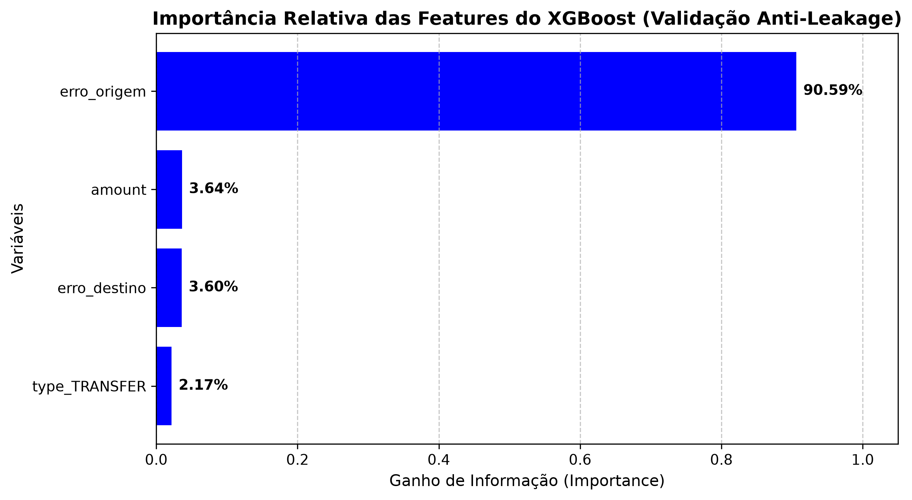
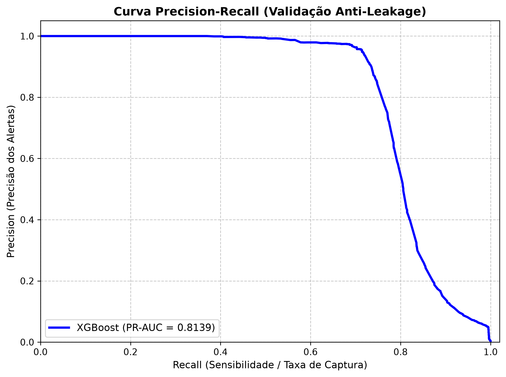

# Operação Pega-Laranja: Investigação de Redes e Modelagem Anti-Fraude (AML)

Pipeline completo de Ciência de Dados desenvolvido para simulação e análise de **Prevenção à Fraude e Anti-Lavagem de Dinheiro (AML)**, investigando contas laranjas (*mule accounts*) no dataset **PaySim** com foco em engenharia anti-leakage, graph analytics e interpretabilidade de modelos.

---

## Visão Geral do Projeto

No ecossistema de pagamentos digitais, criminosos frequentemente utilizam redes de contas intermediárias para pulverizar e lavar dinheiro roubado antes de efetuar o saque final. Este projeto aborda o problema sob a ótica de um ambiente corporativo de ciência de dados aplicada à análise de risco, utilizando o dataset público **PaySim (Financial Datasets for Fraud Detection)**, disponível no [Kaggle](https://www.kaggle.com/datasets/ealaxi/paysim1).

O pipeline é estruturado em duas grandes frentes:

1. **Fase Exploratória e de Redes:** Ingestão de mais de 6 milhões de registros em banco SQLite, auditoria de dados, consultas SQL avançadas e mapeamento visual de grafos de transferência.
2. **Fase Preditiva e Anti-Leakage:** Mitigação de vazamento de dados estrutural, criação de engenharia de recursos contábeis, comparação rigorosa de algoritmos (Regressão Logística e XGBoost) e otimização focada em impacto de negócio.

---

## Tecnologias Utilizadas

- **Linguagem:** Python 3.x
- **Banco de Dados:** SQLite & SQL
- **Manipulação & Modelagem:** Pandas, NumPy, Scikit-Learn (Modelos Lineares / Baseline)
- **Ensembles:** XGBoost
- **Redes & Visualização:** NetworkX, Matplotlib, Seaborn

---

## Destaques Técnicos & Abordagem

- **Graph Analytics (NetworkX):** Mapeamento de redes de transferência para identificar padrões topológicos de esvaziamento de contas e pulverização de capital.
- **Mitigação de Data Leakage:** Identificação e remoção de colunas estruturais do simulador que geravam vazamento de dados, substituindo-as por engenharia de recursos contábeis (`erro_origem` e `erro_destino`).
- **Modelagem Preditiva:** Comparação entre Regressão Logística e **XGBoost**, equilibrando o Recall de fraudes com a contenção severa de falsos positivos.

---

## Arquitetura e Fluxo do Projeto

1. **Ingestão e Banco Relacional:** Processamento de 6+ milhões de registros utilizando chunks em SQLite para otimização de memória.
2. **Análise Exploratória (EDA):** Auditoria comportamental comprovando que 100% das fraudes ocorrem em transferências e saques.
3. **Engenharia Anti-Leakage:** Criação de variáveis de desvio contábil que responderam por mais de **90% do ganho de informação** do modelo final.
4. **Machine Learning & Otimização:** O **XGBoost** atingiu **99% de Recall** reduzindo em **74% os falsos positivos** em comparação aos modelos lineares, preservando a experiência de clientes legítimos (*UX*).

---

## Resultados e Performance do Modelo

A avaliação no conjunto de teste isolado (`30%` da base, estratificada) demonstrou uma evolução drástica de desempenho:

- **Taxa de Captura (Recall):** **99%** (capturou 2.444 das 2.464 fraudes reais na base de teste, deixando escapar apenas 20 ocorrências).
- **Redução de Falsos Positivos:** O XGBoost reduziu em **74% o volume de alarmes falsos** em comparação ao modelo linear otimizado (caindo de ~173 mil para ~45 mil falsos positivos), mantendo o mesmo nível de blindagem.
- **Métrica PR-AUC:** **0.8139**, comprovando a robustez estatística do classificador em cenários de forte desbalanceamento.

### Artefatos Visuais Principais

- **Importância das Variáveis:** O ganho de informação revelou que `erro_origem` concentrou **90,59%** da relevância do modelo, provando o sucesso da blindagem anti-leakage.

- **Curva Precision-Recall:** Mapeia o *trade-off* estável entre a precisão dos alertas e a taxa de captura de fraudes.


---

## Visão Aplicada ao Negócio & Produção

Em ambientes reais de tecnologia financeira, métricas puras de laboratório precisam ser traduzidas em impacto operacional:

- **Mitigação de Risco Regulatório:** Com **99% de Recall**, o modelo blinda a instituição contra perdas financeiras diretas e penalidades severas de órgãos reguladores (Banco Central e COAF).
- **Experiência do Cliente (Fricção Operacional):** Bloquear clientes legítimos por engano destrói o *User Experience*. Para mitigar os falsos positivos remanescentes em produção, recomenda-se que transações sinalizadas de média probabilidade passem por **autenticação em duas etapas via SMS/biometria (*Step-Up Authentication*)**, reservando o bloqueio automático estrito apenas para operações de altíssimo risco.

---

## Estrutura do Repositório

```txt
projeto-aml-paysim/
│
├── data/                    # Banco SQLite e bases 
├── notebooks/               # Jupyter Notebooks de EDA e Modelagem
│   ├── 02_eda_e_investigacao.ipynb
│   └── 03_modelo_ml_preditivo.ipynb
├── src/                     # Scripts de ingestão e pipeline em .py
│   └── 01_ingestao_dados.py
├── output/                  # Gráficos e matrizes geradas
├── .gitignore
├── README.md
└── requirements.txt
```

---

## Como Executar o Projeto

Clone o repositório:

```bash
git clone https://github.com/m-mnzs/projeto-aml-paysim.git
cd projeto-aml-paysim
```

Instale as dependências:

```bash
pip install -r requirements.txt
```

Execute o script na pasta src/ e notebooks na pasta notebooks/ seguindo a numeração sequencial para reproduzir a ingestão, a EDA e a modelagem preditiva.
