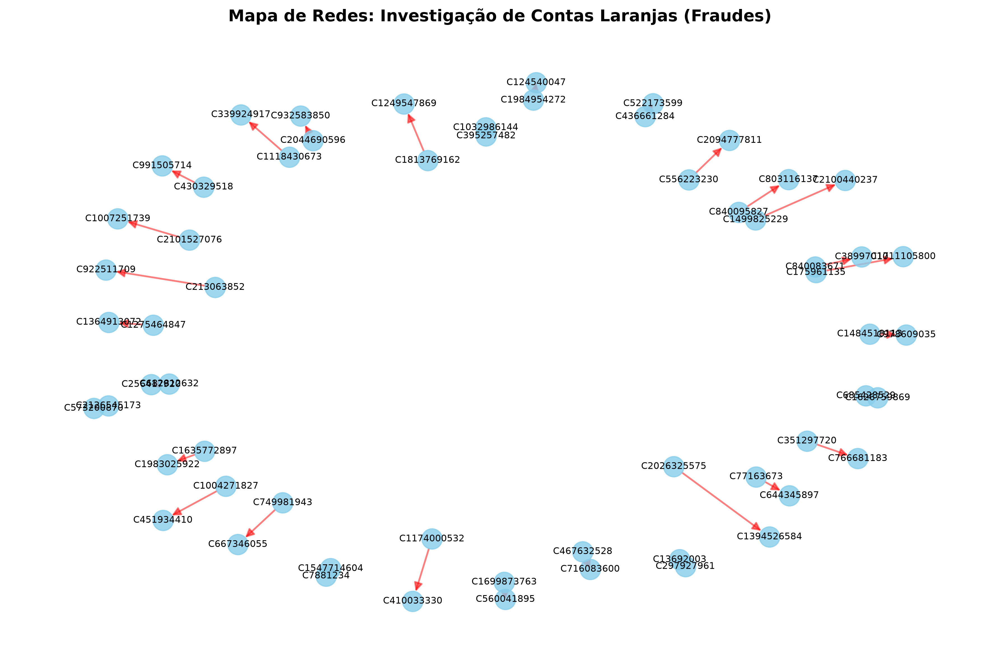
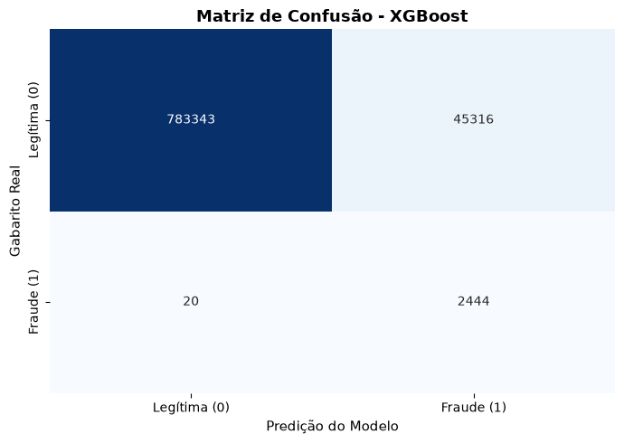
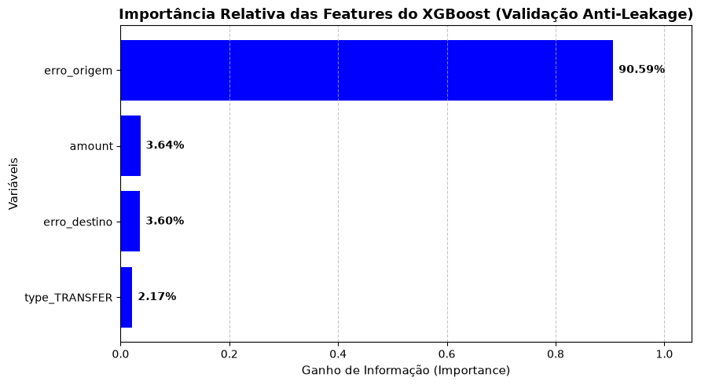

# Operação Pega-Laranja: Investigação de Redes, Engenharia Anti-Leakage e Modelagem Preditiva (AML)

Pipeline completo de Ciência de Dados de ponta a ponta desenvolvido para simulação e análise de **Prevenção à Fraude e Anti-Lavagem de Dinheiro (AML)**, investigando o comportamento de contas laranjas (*mule accounts*) e implementando modelos preditivos de alta performance com o dataset **PaySim**.

---

## Visão Geral do Projeto
No ecossistema de pagamentos digitais, criminosos frequentemente utilizam redes de contas intermediárias para pulverizar e lavar dinheiro roubado antes de efetuar o saque final. O projeto aborda o problema sob a ótica de um ambiente corporativo de engenharia de risco, estruturado em duas grandes frentes:
1. **Fase Exploratória e de Redes:** Ingestão de mais de 6 milhões de registros em banco SQLite, auditoria de dados, consultas SQL avançadas e mapeamento visual de grafos de transferência.
2. **Fase Preditiva e Anti-Leakage:** Mitigação de vazamento de dados estrutural, criação de engenharia de recursos contábeis, comparação rigorosa de algoritmos (Regressão Logística, XGBoost e LightGBM) e otimização focada em impacto de negócio.

---

## Tecnologias e Ferramentas Utilizadas
- **Python 3.x** (Linguagem principal)
- **SQLite & SQL** (Armazenamento relacional otimizado por lotes/chunks e indexação)
- **Pandas & NumPy** (Manipulação e estruturação de dados)
- **Scikit-Learn** (Métricas, pré-processamento e modelos lineares)
- **XGBoost & LightGBM** (Algoritmos de *Ensemble* baseados em árvores)
- **NetworkX & Matplotlib / Seaborn** (Análise de redes e visualizações estratégicas)

---

## Fase 1: Exploração, EDA e Análise de Redes (Graph Analytics)

### Principais Descobertas Iniciais:
* **Escopo de Risco:** Auditoria confirmou que **100% das fraudes** ocorrem exclusivamente nas modalidades de transferência (`TRANSFER`) e saque (`CASH_OUT`).
* **Assinatura Comportamental:** O valor médio das fraudes é consideravelmente superior ao das transações legítimas, caracterizado pelo esvaziamento total do saldo de origem (`newbalanceOrig = 0`).

### Mapeamento de Redes (Graph Analytics)

*Visualização de conexões entre contas de origem e destino em transações fraudulentas utilizando NetworkX.*

---

## Fase 2: O Desafio do *Data Leakage* e Engenharia de Recursos
O dataset PaySim possui colunas de saldo bruto (`oldbalanceOrg`, `newbalanceOrig`, etc.) que carregam a regra matemática exata do simulador. 
* **O Problema:** Alimentar modelos com essas colunas faz com que o algoritmo "decore" o gabarito interno do simulador, mascarando a real capacidade de generalização.
* **A Solução (Erros Contábeis):** Removemos as colunas brutas e criamos *features* de desvio contábil para capturar inconsistências financeiras reais:
  $$\text{erro\_origem} = (\text{oldbalanceOrg} - \text{amount}) - \text{newbalanceOrig}$$
  $$\text{erro\_destino} = (\text{oldbalanceDest} + \text{amount}) - \text{newbalanceDest}$$

---

## Fase 3: Jornada de Modelagem e Resultados

| Modelo | Estratégia / Ajuste | Recall (Fraudes) | Falsos Positivos | Status no Projeto |
| :--- | :--- | :---: | :---: | :--- |
| **Regressão Logística (Baseline)** | Dados crus (Com Vazamento) | 46% | 111 | Descartado (Data Leakage) |
| **Regressão Logística (Limpo)** | Base higienizada (Sem Leakage) | 43% | 155 | Teto dos modelos lineares |
| **Regressão Logística (Otimizado)** | Pesos balanceados + Threshold = 0.20 | **99%** | 173.870 | Inviável operacionalmente (Excesso de alarmes) |
| **XGBoost** | `scale_pos_weight` + Base limpa | **99%** | **45.316** | **Modelo Campeão** |
| **LightGBM** | `scale_pos_weight` + Base limpa | **99%** | 89.668 | Rápido, mas alto volume de falsos positivos |

### Evidências Visuais do XGBoost Campeão:
* **Matriz de Confusão (Heatmap):** Evidencia o alto poder de captura com controle rigoroso de falsos alarmes.

* **Feature Importance (Gain):** Prova que a *feature* criada `erro_origem` responde por mais de **90% do ganho de informação** do modelo, atestando o sucesso da abordagem anti-leakage.


---

## Impacto de Negócio e Considerações para Produção

1. **Apetite ao Risco (*Security*):** Com uma taxa de captura (*Recall*) de **99%**, o modelo blindou o sistema contra quase a totalidade das tentativas de fraude, prevenindo perdas financeiras e riscos de conformidade regulatória (Banco Central / COAF).
2. **Eficiência Operacional:** O **XGBoost** cortou em quase **74% o volume de falsos positivos** em comparação à Regressão Logística otimizada, preservando a experiência de dezenas de milhares de clientes legítimos (*UX*).
3. **Próximos Passos (Arquitetura de Produção):**
   * **Fila de Análise Humana (*Human-in-the-loop*):** Encaminhar transações de média probabilidade para validação via SMS/Biometria em vez de bloqueio automático cego.
   * **Limiares Dinâmicos:** Aplicar regras mais restritas para faixas de valores elevados.

---

## Como Executar o Projeto

Clone o repositório para o seu ambiente local:
```bash
git clone https://github.com/m-mnzs/projeto-aml-paysim.git 
```
Acesse o diretório do projeto e instale as dependências necessárias:
```bash 
pip install pandas numpy scikit-learn xgboost lightgbm matplotlib seaborn networkx
```
Execute os scripts e notebooks na pasta notebooks/ seguindo a numeração sequencial para reproduzir a ingestão, a EDA e a modelagem preditiva. 

---

## Estrutura do Repositório
```text
projeto_aml_paysim/
│
├── data/                      # Banco SQLite e bases processadas
├── notebooks/                 # Jupyter Notebooks organizados por etapas
│   ├── 01_ingestao_dados.py   # Script de engenharia e criação do banco SQLite
│   ├── 02_eda_e_investigacao.ipynb # EDA, queries SQL e NetworkX
│   └── 03_modelo_ml_preditivo.ipynb # Modelagem, anti-leakage e ensembles
├── output/                   # Gráficos, matrizes de confusão e mapas de redes
└── README.md                  # Documentação oficial do projeto